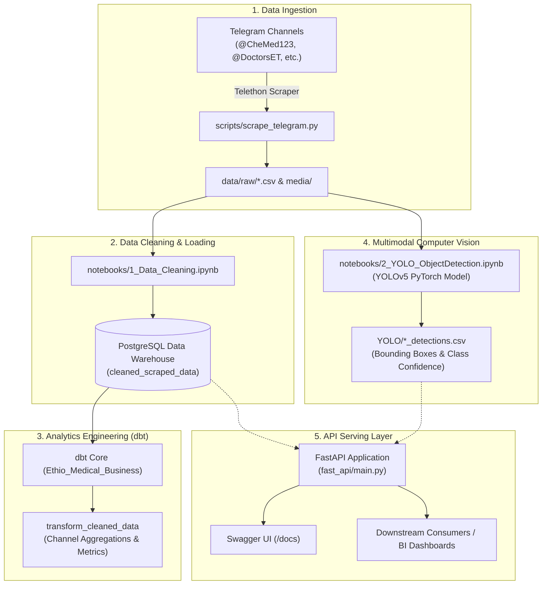

# Ethiopian Medical Data Warehouse & Multimodal YOLO Object Detection Pipeline

[](https://www.python.org/)
[](https://www.postgresql.org/)
[](https://www.getdbt.com/)
[](https://github.com/ultralytics/yolov5)
[](https://fastapi.tiangolo.com/)
[](LICENCE.md)

An end-to-end data engineering and multimodal AI pipeline designed to collect, clean, model, analyze, and serve Ethiopian medical commerce and public health information extracted from Telegram channels.

The system combines **distributed data scraping (Telethon)**, **relational data warehousing (PostgreSQL)**, **modern analytics engineering (dbt)**, **computer vision (YOLOv5 object detection)**, and a high-performance **REST API (FastAPI)**.

---

## 1. Architecture Overview



---

## 2. Key Features

* **Automated Telegram Scraping:** Tracks channel message histories, detects latest message IDs to prevent duplicates, and safely downloads attached media.
* **Robust Data Cleaning:** Handles missing data, deduplicates records, and exports normalized datasets directly into PostgreSQL via SQLAlchemy.
* **Analytics Engineering with dbt:** Modularity and testability for channel metrics, message frequencies, and time-series boundaries.
* **Computer Vision Enrichment:** Detects objects (medical packaging, bottles, persons, equipment) in scraped images, outputting confidence scores and bounding boxes.
* **FastAPI Microservice:** Exposes health status, channel summaries, dbt warehouse views, YOLO detections, and full CRUD operations.

---

## 3. Repository Structure

```text
.
├── dbt/
│   └── Ethio_Medical_Business/    # dbt transformation models, seeds, and schema
│       ├── models/                # SQL transformation models
│       ├── dbt_project.yml        # dbt project definition
│       └── README.md              # dbt specific documentation
├── docs/
│   └── images/                    # Swagger & dbt documentation test captures
├── fast_api/
│   ├── crud.py                    # Database operations & CSV detections parsing
│   ├── database.py                # SQLAlchemy engine and session dependency
│   ├── main.py                    # FastAPI application routes
│   ├── models.py                  # SQLAlchemy ORM models
│   ├── schemas.py                 # Pydantic validation schemas
│   └── README.md                  # API documentation and testing guide
├── notebooks/
│   ├── 1_Data_Cleaning.ipynb      # Telegram text & media data cleaning
│   └── 2_YOLO_ObjectDetection.ipynb # YOLOv5 image inference pipeline
├── scripts/
│   ├── data_exporter.py           # Pandas to PostgreSQL exporter
│   ├── db_connection.py           # Database connection factory
│   ├── logger_config.py           # Centralized logging configuration
│   └── scrape_telegram.py         # Async Telethon scraper
├── YOLO/
│   └── image0_detections.csv      # Extracted object bounding boxes and confidences
├── .env.example                   # Template environment variables
├── .gitignore                     # Production Git ignore rules
├── requirements.txt               # Pinned Python dependencies
└── README.md                      # Project documentation
```

---

## 4. Getting Started

### Prerequisites

* Python 3.10+
* PostgreSQL 14+
* Telegram API Credentials (`api_id`, `api_hash`) from [my.telegram.org](https://my.telegram.org)

### Installation

1. **Clone the repository:**
   ```bash
   git clone https://github.com/Seife1/Data-Warehouse-and-Object-Detection.git
   cd Data-Warehouse-and-Object-Detection
   ```

2. **Create and activate a virtual environment:**
   ```bash
   # Windows
   python -m venv venv
   .\venv\Scripts\activate

   # Linux / macOS
   python3 -m venv venv
   source venv/bin/activate
   ```

3. **Install dependencies:**
   ```bash
   pip install -r requirements.txt
   ```

4. **Configure Environment Variables:**
   Copy `.env.example` to `.env` and fill in your credentials:
   ```bash
   cp .env.example .env
   ```
   ```ini
   # Telegram API Credentials
   API_ID=your_api_id
   API_HASH=your_api_hash
   PHONE_NUMBER=+251900000000

   # PostgreSQL Data Warehouse
   DB_HOST=localhost
   DB_PORT=5432
   DB_NAME=medical_warehouse
   DB_USER=postgres
   DB_PASSWORD=your_password
   ```

---

## 5. Pipeline Walkthrough

### Step 1: Telegram Ingestion
Execute the asynchronous scraper to pull recent messages and media from target medical channels:
```bash
python scripts/scrape_telegram.py
```
Raw CSV files will be stored in `data/raw/` and images in `media/`.

### Step 2: Data Cleaning & Warehouse Loading
Open and run [notebooks/1_Data_Cleaning.ipynb](notebooks/1_Data_Cleaning.ipynb) to:
* Clean text formatting and fill missing metadata.
* Drop invalid records.
* Export the cleaned dataset to the `cleaned_scraped_data` table in PostgreSQL.

### Step 3: dbt Analytics Transformation
Navigate to the dbt project and run transformations:
```bash
cd dbt/Ethio_Medical_Business
dbt deps
dbt run
dbt test
```
To view the interactive lineage graph and schema docs:
```bash
dbt docs generate
dbt docs serve
```

### Step 4: YOLO Object Detection
Run [notebooks/2_YOLO_ObjectDetection.ipynb](notebooks/2_YOLO_ObjectDetection.ipynb) to execute object detection across scraped medical media:
* Uses YOLOv5 PyTorch weights to classify products, packaging, and people.
* Exports detected entities with bounding boxes (`xmin`, `ymin`, `xmax`, `ymax`) and confidence scores to CSV.

### Step 5: Launch FastAPI Service
Start the REST API server:
```bash
uvicorn fast_api.main:app --reload --port 8000
```
Open interactive Swagger documentation at: **[http://localhost:8000/docs](http://localhost:8000/docs)**.

---

## 6. REST API Endpoints

| Category | Method | Endpoint | Description |
| :--- | :--- | :--- | :--- |
| **System** | `GET` | `/` | Service metadata and endpoint catalog |
| **System** | `GET` | `/health` | Health check & database connection probe |
| **Warehouse** | `GET` | `/api/v1/channels` | List all scraped channels and message volumes |
| **Warehouse** | `GET` | `/api/v1/analytics/summary` | Channel aggregate metrics (first/last dates, totals) |
| **Computer Vision** | `GET` | `/api/v1/detections` | Query YOLO detections with `label` & `min_confidence` |
| **Messages CRUD** | `POST` | `/items/` | Insert a new scraped message record |
| **Messages CRUD** | `GET` | `/items/` | Paginated message records (`skip`, `limit`) |
| **Messages CRUD** | `GET` | `/items/{item_id}` | Retrieve specific message record by ID |

---

## 7. License

Distributed under the MIT License. See [LICENCE.md](LICENCE.md) for more information.
