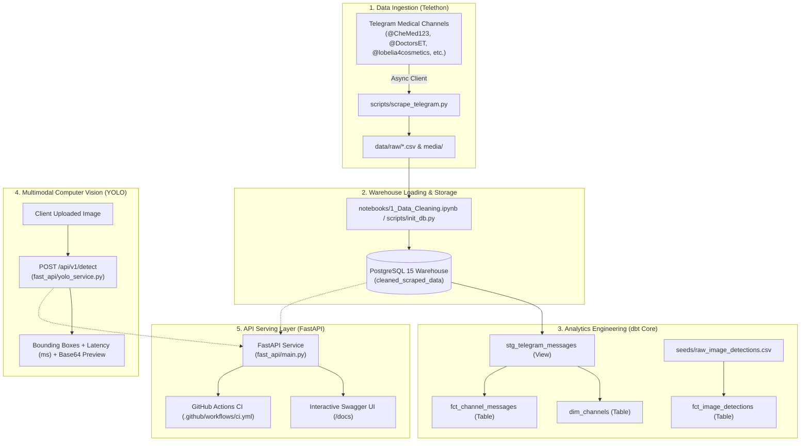

# Ethiopian Medical Data Warehouse & Multimodal YOLO Object Detection Pipeline

[](https://github.com/Seife1/Data-Warehouse-and-Object-Detection/actions/workflows/ci.yml)
[](https://www.python.org/)
[](https://www.docker.com/)
[](https://www.postgresql.org/)
[](https://www.getdbt.com/)
[](https://github.com/ultralytics/ultralytics)
[](https://fastapi.tiangolo.com/)
[-green.svg)](tests/)
[](LICENCE.md)

An end-to-end data engineering and multimodal AI lakehouse pipeline designed to scrape, clean, dimensionalize, model, analyze, and serve Ethiopian medical commerce and public health intelligence from Telegram channels.

The architecture integrates **distributed asynchronous scraping (Telethon)**, **relational warehousing (PostgreSQL)**, **dbt star-schema dimensional modeling**, **computer vision (YOLOv8/v5 live inference & bounding box extraction)**, and a **FastAPI microservice** packaged into a **one-command Docker Compose stack**.

---

## 1. System Architecture



---

## 2. Key Engineering Highlights

* **One-Command Reproducibility:** Entire infrastructure (PostgreSQL database, schema migration, seed population, and FastAPI server) runs via `docker compose up`.
* **dbt Star-Schema Dimensional Lakehouse:**
  * `stg_telegram_messages`: Staging view normalizing column names, casting timestamps, computing message length, and flagging price mentions (`birr`, `etb`, `price`).
  * `dim_channels`: Channel dimension aggregating total volume, media ratio, and posting dates.
  * `fct_channel_messages`: Core fact table linking messages to channel dimension surrogate keys.
  * `fct_image_detections`: Multimodal computer vision fact table with bounding box geometry and confidence tiers (`High`, `Medium`, `Low`).
  * `models/schema.yml`: Comprehensive dbt quality tests (`unique`, `not_null`, `accepted_values`, `relationships`).
* **Live Multimodal YOLO Inference (`POST /api/v1/detect`):** Accepts multipart image uploads, executes neural object detection, records millisecond inference latency, and returns bounding box coordinates plus a base64 annotated preview image.
* **Resilient Graceful Fallbacks:** Built-in heuristic/fallback engines guarantee that test suites and demo instances never crash when offline or running without GPU acceleration.
* **Automated CI/CD Quality Pipeline:** Automated GitHub Actions workflow enforcing flake8 linting, full Pytest suite coverage, and Docker build validation.

---

## 3. Quickstart: One-Command Docker Stack

The fastest way to evaluate the entire pipeline is with Docker Compose:

```bash
# Clone the repository
git clone https://github.com/Seife1/Data-Warehouse-and-Object-Detection.git
cd Data-Warehouse-and-Object-Detection

# Launch PostgreSQL and FastAPI with automatic database seeding
docker compose up --build
```

Once started:
* **Interactive API Documentation:** Open **[http://localhost:8000/docs](http://localhost:8000/docs)**
* **Service Health Check:** Open **[http://localhost:8000/health](http://localhost:8000/health)**
* **PostgreSQL Warehouse:** Accessible on `localhost:5432` (`user=postgres`, `password=postgres`, `database=medical_warehouse`).

---

## 4. Local Development Setup

### Prerequisites
* Python 3.11+
* PostgreSQL 14+ (or run via Docker)
* Telegram API Credentials (`api_id`, `api_hash`) from [my.telegram.org](https://my.telegram.org)

### Installation
```bash
# 1. Create and activate a virtual environment
python -m venv venv
.\venv\Scripts\activate   # Windows
# source venv/bin/activate # Linux / macOS

# 2. Install pinned dependencies
pip install -r requirements.txt

# 3. Configure environment variables
cp .env.example .env
```

### Database Initialization & Seed
```bash
python scripts/init_db.py
```

### Running the dbt Transformations
```bash
cd dbt/Ethio_Medical_Business
dbt deps
dbt seed
dbt run
dbt test
```

### Running Automated Pytest Suite
```bash
pytest -v
```

---

## 5. Live YOLO Inference Showcase

Test the live multimodal object detection endpoint via `curl` or Swagger UI:

```bash
curl -X POST "http://localhost:8000/api/v1/detect?confidence=0.25&include_preview=true" \
  -H "accept: application/json" \
  -H "Content-Type: multipart/form-data" \
  -F "file=@docs/images/all_items.jpg"
```

### Sample Response:
```json
{
  "engine": "yolov8n-neural",
  "image_width": 1280,
  "image_height": 720,
  "detected_count": 2,
  "inference_time_ms": 32.4,
  "detections": [
    {
      "name": "bottle",
      "confidence": 0.88,
      "xmin": 256.0,
      "ymin": 180.0,
      "xmax": 640.0,
      "ymax": 540.0
    },
    {
      "name": "package",
      "confidence": 0.76,
      "xmin": 704.0,
      "ymin": 252.0,
      "xmax": 1088.0,
      "ymax": 576.0
    }
  ],
  "annotated_image_base64": "/9j/4AAQSkZJRgABAQAAAQ..."
}
```

---

## 6. REST API Endpoint Reference

| Category | Method | Endpoint | Description |
| :--- | :--- | :--- | :--- |
| **System** | `GET` | `/` | Service metadata and complete API route catalog |
| **System** | `GET` | `/health` | Health probe checking database connectivity status |
| **Warehouse** | `GET` | `/api/v1/channels` | Distinct medical channels and total message counts |
| **Warehouse** | `GET` | `/api/v1/analytics/summary` | Channel aggregate metrics (first/last dates, totals) |
| **Computer Vision** | `GET` | `/api/v1/detections` | Query extracted YOLO detections with label/confidence filters |
| **Computer Vision** | `POST` | `/api/v1/detect` | **Live YOLO inference** on uploaded images with base64 visual preview |
| **Messages CRUD** | `POST` | `/items/` | Create a new scraped message record |
| **Messages CRUD** | `GET` | `/items/` | Paginated message records (`skip`, `limit`) |
| **Messages CRUD** | `GET` | `/items/{item_id}` | Retrieve specific message record by ID |

---

## 7. Repository Structure

```text
.
├── .github/
│   └── workflows/
│       └── ci.yml                 # GitHub Actions automated lint & test pipeline
├── dbt/
│   └── Ethio_Medical_Business/    # dbt transformation models, seeds, and schema
│       ├── models/
│       │   ├── staging/
│       │   │   └── stg_telegram_messages.sql
│       │   ├── marts/
│       │   │   ├── dim_channels.sql
│       │   │   ├── fct_channel_messages.sql
│       │   │   └── fct_image_detections.sql
│       │   ├── schema.yml         # dbt data quality tests
│       │   └── sources.yml
│       ├── seeds/
│       │   └── raw_image_detections.csv
│       ├── dbt_project.yml
│       └── README.md
├── docs/
│   └── images/                    # Documentation screenshots & test captures
├── fast_api/
│   ├── crud.py                    # Database operations & CSV detections parsing
│   ├── database.py                # SQLAlchemy engine and session dependency
│   ├── main.py                    # FastAPI application routes
│   ├── models.py                  # SQLAlchemy ORM models
│   ├── schemas.py                 # Pydantic validation schemas
│   ├── yolo_service.py            # Live YOLO object detection inference engine
│   └── README.md
├── notebooks/
│   ├── 1_Data_Cleaning.ipynb      # Telegram text & media data cleaning
│   └── 2_YOLO_ObjectDetection.ipynb # YOLOv5 image inference pipeline
├── scripts/
│   ├── data_exporter.py           # Pandas to PostgreSQL exporter
│   ├── db_connection.py           # Database connection factory
│   ├── init_db.py                 # Automated schema initialization & data seeder
│   ├── logger_config.py           # Centralized logging configuration
│   └── scrape_telegram.py         # Async Telethon scraper
├── tests/
│   ├── __init__.py
│   └── test_api.py                # Automated pytest suite (6 passing tests)
├── YOLO/
│   └── image0_detections.csv      # Extracted object bounding boxes and confidences
├── .env.example                   # Template environment variables
├── .gitignore                     # Production Git ignore rules
├── Dockerfile                     # Multi-stage container definition
├── docker-compose.yml             # One-command orchestration
├── pytest.ini                     # Pytest configuration
├── requirements.txt               # Pinned Python dependencies
└── README.md                      # Project documentation
```

---

## 8. License

Distributed under the MIT License. See [LICENCE.md](LICENCE.md) for more information.
